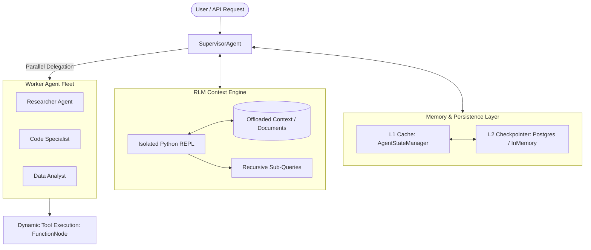

<div align="center">

# ⚡ Asera Core

**A Modular Multi-Agent Orchestration Framework with Native Gemini 2.0 Integration & Recursive Context Management (RLM)**

[](https://www.python.org/downloads/)
[](https://opensource.org/licenses/MIT)
[](https://deepmind.google/technologies/gemini/)
[](https://arxiv.org/abs/2512.24601)

</div>

---

## 📖 Overview

**Asera Core** is an enterprise-grade, lightweight Python framework designed to build, orchestrate, and supervise networks of autonomous AI agents. Powered natively by Google Gemini 2.0, Asera Core eliminates the heavy abstractions and slow runtimes of legacy agent libraries in favor of **strict type-safety, automatic JSON schema inference, parallel sub-agent delegation, and infinite-context reasoning via Recursive Language Models (RLMs)**.

Whether you need a single tool-augmented assistant, a hierarchical multi-agent supervisor team, or zero-prompt-bloat context analysis over massive corporate documents, Asera Core gives you the building blocks.

---

## 🌟 Key Highlights

- 🧠 **Native Gemini 2.0 Integration:** Built directly against Google GenAI SDK with first-class support for thought signature preservation, dynamic function calling, and token streaming.
- 👔 **Supervisor Orchestration:** Dynamic agent routing without hardcoded graphs. The supervisor generates routing schemas on the fly and coordinates worker agents with `asyncio.gather`.
- 🔬 **Recursive Context Management (RLM):** Offloads massive document payloads into an isolated, safe Python REPL. The agent inspects, slices, and recurses over data programmatically—avoiding context exhaustion and high token costs.
- ⚡ **Auto Schema Generation:** Turn any Python function (sync or async) into an LLM-callable tool using simple `@agent.tool` decorators with zero manual JSON schema authoring.
- 💾 **Dual-Tier State & Persistence:** Thread-safe in-memory L1 cache (`AgentStateManager`) paired with pluggable L2 persistence (`PostgresCheckpointSaver` and `InMemoryCheckpointSaver`).
- 🌊 **First-Class Streaming:** Native async generator streaming via `ainvoke()`, yielding both token chunks and real-time internal execution events.

---

## 🏛️ Architecture



---

## 🚀 Quickstart

### Installation

```bash
# Clone and install locally
git clone https://github.com/Black-fox17/asera-core.git
cd asera-core
pip install -e .

# Or with PostgreSQL persistence support
pip install -e ".[postgres]"
```

Set your Google AI API key:

```bash
export GEMINI_API_KEY="your-gemini-api-key"
```

### 1. Build an Autonomous Agent in 15 Seconds

```python
import asyncio
from asera import Agent

async def main():
    agent = Agent(
        name="finance_bot",
        description="Calculates compound interest and investment returns"
    )

    @agent.tool
    def compound_interest(principal: float, annual_rate: float, years: int) -> float:
        """Calculate compound interest."""
        return principal * ((1 + annual_rate) ** years)

    response = await agent.invoke(
        "If I invest $10,000 at 7% annual interest for 5 years, what will my return be?"
    )
    print(response)

asyncio.run(main())
```

---

## 🧩 Core Concepts

### 1. Supervisor Agent & Multi-Agent Collaboration

The `SupervisorAgent` automatically inspects all attached worker agents, synthesizes a dynamic dispatch schema, routes tasks, and executes parallel delegations:

```python
from asera import MultiAgentSystem

system = MultiAgentSystem()

# Specialist 1: Technical Researcher
researcher = system.create_agent(
    name="researcher",
    description="Researches technical documentation and specifications."
)

@researcher.tool
def lookup_spec(standard: str) -> str:
    """Fetch official standard specification."""
    return f"{standard}: Specification requires TLS 1.3 encryption."

# Specialist 2: Security Reviewer
reviewer = system.create_agent(
    name="security_auditor",
    description="Audits architecture designs against security policies."
)

# Run coordinated workflow
response = await system.run(
    "Verify if our current auth architecture adheres to the OAuth2.1 standard."
)
print(response)
```

---

### 2. Recursive Language Model (RLM) Context Management

Traditional RAG or prompt dumping wastes tokens and degrades retrieval quality. Asera Core incorporates **RLM**: offloading massive contexts into an execution environment where the model programmatically queries data:

```python
from asera import RLMContext

rlm = RLMContext(
    model="gemini-2.0-flash",
    max_depth=1,
    max_iterations=8
)

giant_contract = "... (150 pages of legal text) ..."

result = rlm.query(
    prompt="Extract the indemnification cap and list all governing jurisdictions.",
    context=giant_contract
)
print(result)
```

**How RLM Works Inside Asera Core:**
1. The raw context is stored in a clean `LocalREPL` as `context`.
2. The agent executes Python snippets (`len(context)`, `re.search(...)`, chunk slices).
3. The agent calls `llm_query(subtask)` only on small, focused slices.
4. When finished, it outputs `FINAL<<<answer>>>` with zero prompt overflow.

---

### 3. Real-Time Streaming (`ainvoke`)

Stream agent tokens chunk-by-chunk while preserving background tool notifications:

```python
import sys
from asera import SupervisorAgent

supervisor = SupervisorAgent()
# ... attach worker agents ...

async for chunk in supervisor.ainvoke("Write an in-depth report on quantum computing:"):
    if isinstance(chunk, str):
        sys.stdout.write(chunk)
        sys.stdout.flush()
    elif isinstance(chunk, dict):
        print(f"\n[Event: {chunk['name']}]")
```

---

### 4. Conversation Checkpoints & Multi-Turn Memory

Maintain session continuity across distributed nodes using thread-isolated checkpoints:

```python
from asera import MultiAgentSystem, InMemoryCheckpointSaver

saver = InMemoryCheckpointSaver() # or PostgresCheckpointSaver(pool)
system = MultiAgentSystem(checkpoint_saver=saver)

# Set conversation thread
system.set_thread("session-user-8492")

await system.run("My deployment cluster is located in eu-central-1.")
response = await system.run("Where is my cluster deployed?")
# Agent recalls 'eu-central-1' from persistent session state
```

---

## 📊 Comparison with Existing Frameworks

| Feature | Asera Core | LangChain | CrewAI | LangGraph |
| :--- | :---: | :---: | :---: | :---: |
| **Native Gemini 2.0 + Thinking** | ✅ Yes | ⚠️ Generic Adapter | ❌ No | ⚠️ Generic Adapter |
| **Zero-Bloat RLM Context** | ✅ Built-in | ❌ RAG Only | ❌ RAG Only | ❌ Complex State Graphs |
| **Auto JSON Schema from Hints** | ✅ Native | ⚠️ Pydantic Overhead | ⚠️ Partial | ❌ Manual |
| **Dynamic Routing without Graph** | ✅ Native | ❌ Complex Router | ⚠️ Hardcoded Roles | ❌ Explicit Graph |
| **Parallel async execution** | ✅ `asyncio.gather` | ⚠️ Heavyweight | ⚠️ ThreadPool | ⚠️ State Machine |
| **Lightweight Footprint** | ✅ Minimal deps | ❌ 100+ dependencies | ❌ Heavyweight | ❌ Steep learning curve |

---

## 📂 Repository Structure

```text
asera-core/
├── asera/                      # Core framework package
│   ├── core/                   # Agent, Supervisor, and System orchestrator
│   │   ├── agent.py
│   │   ├── supervisor.py
│   │   └── system.py
│   ├── context/                # Recursive Language Model context engine
│   │   ├── rlm.py
│   │   ├── repl.py
│   │   └── prompts.py
│   ├── memory/                 # State management & persistent checkpointers
│   │   ├── state.py
│   │   ├── checkpointer.py
│   │   ├── in_memory.py
│   │   └── postgres.py
│   ├── tools/                  # Dynamic schema generators and tool registry
│   │   ├── function_node.py
│   │   └── registry.py
│   ├── exceptions.py           # Custom exception hierarchy
│   ├── logging.py              # Structured logger
│   └── types.py                # Dataclasses and type definitions
├── examples/                   # Executable real-world examples
│   ├── 01_basic_agent.py
│   ├── 02_supervisor_team.py
│   ├── 03_rlm_deep_context.py
│   ├── 04_streaming_supervisor.py
│   └── 05_persistent_memory.py
├── tests/                      # Pytest test suite
│   ├── test_tools.py
│   ├── test_agent.py
│   ├── test_memory.py
│   ├── test_supervisor.py
│   └── test_rlm.py
├── pyproject.toml              # PEP 621 package metadata
└── README.md                   # Complete framework documentation
```

---

## 🧪 Running Tests

```bash
# Run pytest test suite
pytest -v
```

---

## 🤝 Contributing

Contributions are welcome! Please submit issues or pull requests to help expand provider adapters, sandbox backends, and memory stores.

1. Fork the Project
2. Create your Feature Branch (`git checkout -b feature/NewFeature`)
3. Commit your Changes (`git commit -m 'feat: Add NewFeature'`)
4. Push to the Branch (`git push origin feature/NewFeature`)
5. Open a Pull Request

---

## 📄 License

Distributed under the **MIT License**. See [`LICENSE`](LICENSE) for more information.

---

<div align="center">
Developed by <b>Black-fox17</b> for the Asera Ecosystem.
</div>
